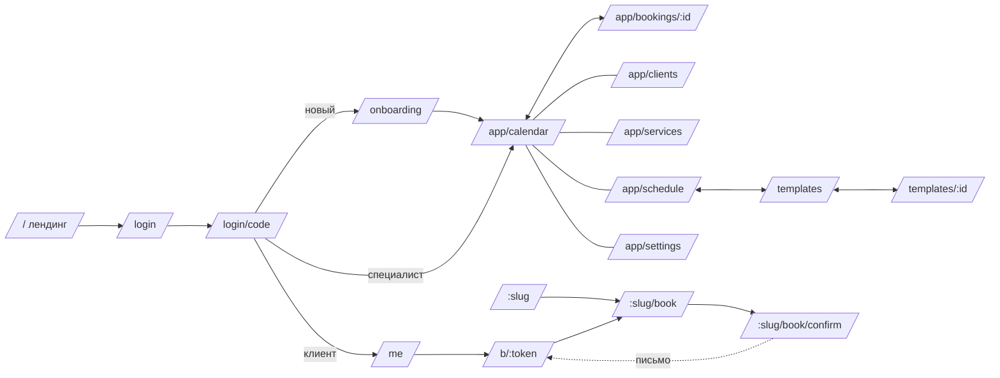

# 07. Информационная архитектура

## 1. Принципы

1. **Две поверхности — два контекста.** Публичная (клиент, бренд специалиста на первом плане) и кабинет (`/app`, бренд продукта, инструменты).
2. **URL — источник истины состояния представления.** Вид календаря, дата, выбранная услуга, день и время записи живут в search-параметрах. Ссылку можно скопировать, кнопка «Назад» работает.
3. **Короткие человекочитаемые адреса** для публичных страниц: `vporu.ru/anna-nails`.
4. **Плоская навигация кабинета:** 5 разделов, ≤ 2 уровня вложенности.

## 2. Карта страниц

| ID | Маршрут | Назначение | Доступ | Индексация |
|---|---|---|---|---|
| P-01 | `/` | Лендинг продукта | все | да |
| P-02 | `/login` | Ввод email (`?returnTo=`, `?intent=specialist\|client`) | гость | нет |
| P-03 | `/login/code` | Ввод кода | гость | нет |
| P-04 | `/onboarding` (`?step=1..3`) | Мастер специалиста | аутентифицирован, без профиля | нет |
| P-10 | `/{slug}` | Публичный профиль специалиста | все | да (настройка) |
| P-11 | `/{slug}/book` (`?service=&date=&time=`) | Выбор услуги, дня и окна | все | нет (`noindex`) |
| P-12 | `/{slug}/book/confirm` (`?service=&start=`) | Контакты, код, подтверждение; затем экран успеха | все | нет |
| P-13 | `/b/{token}` | Управление записью по ссылке из письма | владелец токена | нет |
| P-20 | `/app` | Редирект на `/app/calendar` | специалист | нет |
| P-21 | `/app/calendar` (`?view=day\|week\|list&date=YYYY-MM-DD`) | Календарь записей | специалист | нет |
| P-22 | `/app/bookings/{id}` | Карточка записи (на desktop — панель поверх P-21) | специалист-владелец | нет |
| P-23 | `/app/clients` (`?q=`), `/app/clients/{id}` | Клиенты | специалист | нет |
| P-24 | `/app/services`, `/app/services/{id}` | Услуги | специалист | нет |
| P-25 | `/app/schedule` (`?month=YYYY-MM`) | Месячная сетка, кисть, правила | специалист | нет |
| P-26 | `/app/schedule/templates` | Список шаблонов дня | специалист | нет |
| P-27 | `/app/schedule/templates/{id}` | Редактор шаблона | специалист | нет |
| P-28 | `/app/settings/profile` | Профиль и ссылка, приём записей | специалист | нет |
| P-29 | `/app/settings/booking`, `/notifications`, `/account` | Правила записи (горизонт, сроки), уведомления, аккаунт, сессии, удаление | специалист | нет |
| P-30 | `/me` | Мои записи клиента | клиент | нет |
| P-31 | `/me/settings` | Аккаунт клиента, удаление | клиент | нет |
| P-40 | `/legal/privacy`, `/legal/terms`, `/legal/consent` | Документы | все | да |
| P-90 | 404, 410, 500 | Системные | все | нет |

Маршруты `/api/v1/*` и `/api/auth/*` — API ([16](16-api-specification.md)).

**Зарезервированные slug:** все сегменты первого уровня выше, а также `admin`, `help`, `support`, `static`, `assets`, `about`, `pricing`, `blog`, `status`, `www`, `mail`, `robots.txt`, `sitemap.xml`, `favicon.ico`, плюс список зарезервированных username из `packages/shared` прототипа.

## 3. Навигация

### Кабинет специалиста
- **≥ 1024 px:** левая колонка 240 px — логотип, разделы (Календарь, Клиенты, Услуги, Расписание, Настройки), блок «Ваша ссылка», внизу аккаунт. Контент — справа, контекстные панели — справа от контента.
- **< 1024 px:** верхняя панель (заголовок раздела, «+ Запись») и нижняя панель из 4 пунктов (Календарь, Клиенты, Расписание, Ещё). «Ещё» содержит Услуги, Настройки и ссылку.

**[Решение]** Нижняя панель допустима только в кабинете на телефоне, где специалист работает ежедневно и одной рукой. На публичных страницах её нет: там линейный сценарий ([08](08-ux-specification.md)).

### Публичная поверхность
- Шапка: логотип продукта (мелко, ссылка на `/`), «Мои записи».
- Подвал: «Сделано на Впору», документы.
- Шаги записи: прогресс «Услуга → Время → Контакты» с возвратом к любому шагу.

## 4. Взаимосвязи

## 5. Контентная структура ключевых страниц

**P-10 Профиль специалиста:**
1. Аватар, имя, профессия.
2. «О себе».
3. Адрес и примечание; телефон (если разрешён).
4. Услуги: название, длительность, цена, «Выбрать время».
5. Ближайшее окно («Ближайшее: завтра, 10:30»).
6. Подвал.

**P-11 Выбор времени:**
1. Сводка выбора (боковая колонка на desktop, нижняя панель на телефоне).
2. Услуги (если > 1).
3. Лента дней.
4. Окна по частям дня.
5. Подпись часового пояса.
6. «Продолжить».

**P-21 Календарь:**
1. Тулбар: ‹ Сегодня ›, диапазон, переключатель видов, «+ Запись».
2. Сетка (часы × дни) с фоном рабочих интервалов.
3. Панель записи.

**P-25 Расписание:**
1. Вкладки: Месяц, Шаблоны дня, Исключения и отпуск.
2. Палитра кистей и редактор выбранного шаблона.
3. Месячная сетка.
4. Сводка горизонта.
5. «Заполнить по правилу».

## 6. Состояния (для каждой страницы-списка и формы)

| Состояние | Публичная запись | Календарь | Услуги и шаблоны |
|---|---|---|---|
| Загрузка | Скелетон дней и окон (без сдвига вёрстки) | Скелетон сетки | Скелетон списка |
| Пусто | «Свободного времени пока нет» + контакт | «На этой неделе записей нет» + «Поделиться ссылкой» | «Добавьте первую услугу» + кнопка |
| Ошибка | «Не удалось загрузить расписание» + «Повторить» | То же, данные из кэша остаются видимыми | То же |
| Успех | Экран «Вы записаны» | Тост «Запись перенесена · Вернуть» | Тост «Сохранено» |
| Нет доступа | 404 (не раскрываем существование) | Редирект на вход | Редирект на вход |

## 7. Правила маршрутизации

- Ведущие и замыкающие слеши нормализуются (301 на вариант без завершающего `/`). Slug в нижнем регистре (301 с другого регистра).
- Невалидные search-параметры молча отбрасываются с fallback на значения по умолчанию, без ошибок 400 для навигационных URL. Разбор и валидация — nuqs с парсерами Zod из `contracts`.
- `returnTo` принимает только относительные пути того же origin (защита от open redirect).
- Защищённые разделы (`/app`, `/me`) проверяют сессию в серверном layout и редиректят на `/login?returnTo=…`; `middleware` проверяет только наличие cookie и авторизацией не считается.
