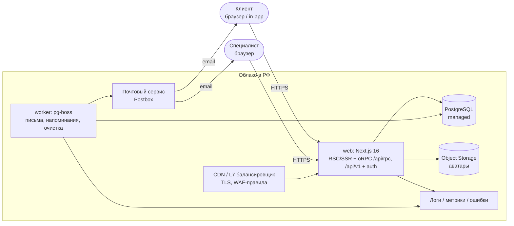

# 14. Целевая архитектура

**Стиль:** модульный монолит на TypeScript. Один web-процесс (SSR + API) и один процесс-воркер, общий PostgreSQL.

**Почему так:**
- нагрузка MVP невелика (NFR-SCAL-01), команда маленькая (AR-09), а ключевые инварианты транзакционные (BKG-02). Микросервисы добавили бы распределённые транзакции без пользы;
- модульность (чёткие границы пакетов и доменных модулей) сохраняет возможность выделить сервисы позже.

## 1. Контекст системы



## 2. Структура кода (монорепозиторий)

```
apps/
  web/            Next.js App Router: публичные страницы (RSC), /app и /me (клиентские экраны + TanStack Query), app/api/[rpc|v1]/[[...rest]] → обработчики oRPC
  worker/         Запуск pg-boss, обработчики задач
packages/
  domain/         Чистый TS без I/O: движок шаблонов и окон, правила заполнения, машина состояний записи, политики
  contracts/      Zod-схемы запросов и ответов, коды ошибок, генерация OpenAPI
  db/             Drizzle-схема, SQL-миграции, репозитории
  api/            Роутер oRPC: процедуры (схема → контекст и сессия → проверка доступа → use case) и middleware (лимиты, логирование, ошибки)
  auth/           Конфигурация Better Auth (web)
  email/          Шаблоны React Email (из прототипа transactional)
  ui/             Дизайн-система: токены, компоненты на React Aria
  config/         tsconfig, линт
  env/            Валидация окружения (@t3-oss/env-core, из прототипа)
```

Правила зависимостей (проверяются линтером):
- `domain` ни от чего не зависит;
- `contracts` → `domain` (типы);
- `api`, `worker` → `domain`, `contracts`, `db`, `email`;
- `web` → `contracts`, `ui`, `api` (только монтирование), `domain` (форматирование).

**[Решение D-07]** Мобильное приложение Expo из прототипа не развивается. Пакеты `shared`, `auth`, `db`, `env` и `transactional` переиспользуются как исходный материал.

## 3. Доменные модули

| Модуль | Ответственность | Ключевые сущности | Требования |
|---|---|---|---|
| Identity | Вход, сессии, удаление аккаунта | user, session, verification | AUTH-* |
| Profile | Профиль специалиста, slug, приём записей, аватар | specialist_profile | PRF-*, AUTH-03 |
| Catalog | Услуги | service | SVC-* |
| Scheduling | Шаблоны, рабочие дни, правила, горизонт | day_template, template_block, work_day, work_day_block, booking_policy (поля профиля) | TPL-*, SCH-* |
| Availability | Расчёт окон (чистая функция) | — (вычисляемое) | AVL-01 |
| Booking | Создание, hold, перенос, отмена, статусы, токены управления | booking, booking_event | BKG-* |
| Clients | Контакты клиентов специалиста | client_contact | CLI-* |
| Notifications | Постановка и отправка писем, .ics | notification | NTF-* |
| Compliance | Согласия, запросы субъектов, обезличивание | consent_record, dsr_request | LEG-* |
| Audit | Журнал значимых действий | audit_log | NFR-SEC |

## 4. Ключевые потоки

### 4.1 Расчёт окон (AVL-01)

```
input: profile(tz, horizon, min_notice, booking_enabled), service, dateRange, workDays+blocks, activeBookings
for each date in range ∩ horizon:
  for each block in workDay(date).blocks where block.service = service:
    step = service.duration + service.buffer
    for i in 0..block.count-1:
      startLocal = date + block.start_minute + i*step    // в tz специалиста
      start = toUTC(startLocal, tz)
      interval = [start, start + duration + buffer)
      if start >= now + min_notice and not overlaps(interval, activeBookings):
        emit slot(start, end = start + duration)
```

- Чистая функция в `packages/domain/availability`: детерминированная, property-based тесты.
- Данные загружаются одним запросом на диапазон (≤ 31 день). Сложность — O(сеансов + записей) с отсортированными интервалами.
- **Решение по снимкам ([22](22-decision-log.md) D-12):** окна строятся из `work_day_block` (снимок на дату), а не из актуального шаблона. Изменение шаблона не меняет назначенные дни. Применение изменений к будущим дням — явное действие «Обновить N будущих дней без записей».

### 4.2 Создание записи гостем (BKG-01, BKG-02)

```mermaid
sequenceDiagram
  participant C as Клиент
  participant W as web (/api/v1)
  participant DB as PostgreSQL
  participant Q as pg-boss
  C->>W: POST /public/{slug}/holds {serviceId, start, name, email, …, consent}
  W->>W: Zod; проверка окна по AVL-01 (domain)
  W->>DB: BEGIN; истечь просроченные hold специалиста; INSERT booking(status=held, hold_expires_at=now+10m); INSERT consent_record
  DB-->>W: OK | exclusion_violation → 409 slot_taken (+alternatives)
  W->>Q: (в той же транзакции) задача send_otp(email)
  W-->>C: 201 {holdId, expiresAt}
  Q->>C: Письмо с кодом
  C->>W: POST /public/holds/{holdId}/confirm {code}
  W->>DB: BEGIN; проверить код; UPDATE booking SET status=confirmed; upsert client_contact; INSERT booking_event; создать сессию клиента
  W->>Q: send_confirmation(client), notify_specialist, schedule reminder(start-24h)
  W-->>C: 200 {booking, manageUrl}
```

- Проверка окна в приложении — для понятной ошибки. **Окончательная гарантия — ограничение БД.**
- Задачи ставятся транзакционно (pg-boss в той же транзакции): нет записи без письма и письма без записи.
- Аутентифицированный клиент вызывает `POST /public/{slug}/bookings`. Hold и подтверждение происходят в одной транзакции.

### 4.3 Применение правила расписания (SCH-02)
1. `POST /schedule/rules/preview` → `domain.expandRule(rule)` → список дат и действий, сводка (дни, окна, конфликты).
2. `POST /schedule/rules/apply` с тем же правилом и `previewHash` (защита от устаревшего предпросмотра) → одна транзакция: upsert `work_day` и замена `work_day_block` для затронутых дат.

## 5. Обработка ошибок

- **Формат:** `application/problem+json` (RFC 9457) с полями `type`, `title`, `status`, `code` (машиночитаемый), `detail`, `requestId`, `errors[]` (поля) — [16](16-api-specification.md) §3.
- **Доменные ошибки** — типизированные результаты (`Result<T, DomainError>`), маппятся в ошибки oRPC (`ORPCError` с кодом из `contracts`) на границе процедур; OpenAPI-обработчик отдаёт их как problem+json.
- **Неожиданные ошибки:** 500 с `requestId`, полная информация только в логах (без ПД).
- **Клиент:** TanStack Query — повтор только для идемпотентных GET (2 раза), мутации без автоповтора; ошибки маппятся на UX-каталог ([08](08-ux-specification.md) §7).
- **Error boundary** на уровне маршрутов с кнопкой «Повторить».

## 6. Аутентификация, авторизация, сессии

| Аспект | Решение |
|---|---|
| Вход | Better Auth email OTP: 6 цифр, TTL 10 мин, 5 попыток |
| Сессия | Cookie `__Host-session`: `HttpOnly; Secure; SameSite=Lax; Path=/`. Запись в БД, срок 30 дней со скользящим продлением; cookie cache подписи 5 мин для снижения нагрузки |
| CSRF | SameSite=Lax + проверка `Origin` для небезопасных методов + JSON-only API (без form-encoded) |
| Роли | `user` (по умолчанию), признак `specialist` (есть `specialist_profile`), `operator` (флаг, Next) |
| Авторизация данных | Каждый use case получает `actor` и проверяет владение: `resource.specialist_id = actor.specialistId`. Запросы к БД всегда фильтруются по `specialist_id`. Чужие ресурсы — 404 |
| Токен управления записью | 32 случайных байта (base64url) в URL, в БД — SHA-256. Права только на одну запись; срок — до конца записи + 30 дней |
| Клиент | Видит записи, где `client_email` = подтверждённый email пользователя |

Row Level Security PostgreSQL — **Next**, как второй рубеж (D-14).

## 7. Файлы

Аватары:
1. Загрузка через web (лимит 10 МБ).
2. Проверка сигнатуры.
3. sharp: декод (HEIC через libheif, если доступен), обрезка 1:1, WebP 512 и 128, удаление EXIF.
4. Object Storage с непредсказуемым ключом.
5. Отдача через CDN.

Старые файлы удаляются задачей.

## 8. Фоновые операции (worker)

| Задача | Триггер | Идемпотентность |
|---|---|---|
| `send_otp` | Запрос кода | Ключ `verification.id` |
| `send_booking_email(kind)` | Создание, изменение, отмена | Ключ `(booking_id, kind, version)` |
| `send_reminder` | Отложенная на `start − 24h`; отменяется при отмене | Проверка статуса перед отправкой |
| `expire_holds` | Каждую минуту | UPDATE … WHERE |
| `complete_bookings` | Каждые 15 мин | Переход `confirmed → completed` после конца + 1 ч |
| `anonymize_deleted` | Ежедневно | Обезличивание аккаунтов старше 30 дней после удаления |
| `retention_sweep` | Ежедневно | Удаление verification, истёкших hold, старых журналов по [15](15-data-model.md) §6 |

Повторы: 3 попытки, экспоненциальная задержка (1, 5, 30 мин), затем dead-letter и алерт.

## 9. Кэширование

| Что | Где | Политика |
|---|---|---|
| Статика (JS, CSS, шрифты) | CDN | Иммутабельные хеш-имена, 1 год |
| Публичный профиль P-10 (HTML) | CDN | `s-maxage=60, stale-while-revalidate=300`; инвалидация при изменении профиля |
| Окна | **Не кэшируются на CDN**. Клиент: `staleTime` 30 с, повторная загрузка при фокусе | Свежесть важнее |
| Данные кабинета | TanStack Query | `staleTime` 30 с, оптимистичные обновления с откатом |
| Сессия | Cookie cache Better Auth | 5 мин |

Аналитика продукта: собственные события (`booking_started`, `slot_selected`, `booking_confirmed`, `onboarding_step`) в таблице `analytics_event` без ПД и IP; агрегаты — SQL-представления. Альтернатива — self-hosted Umami в том же облаке.

## 10. Логирование и мониторинг

- Логи: JSON (pino), поля `ts, level, requestId, route, status, durationMs, actorType`. **Без** email, имён, телефонов, токенов и кодов (redaction-правила и тест).
- Метрики: RED по маршрутам, длина и возраст очереди, ошибки писем, число 409 `slot_taken`, p95 расчёта окон.
- Трассировка: OpenTelemetry → бэкенд облака.
- Ошибки: self-hosted GlitchTip (Sentry-совместимый) в РФ со скраббингом ПД. **[Решение]** Sentry SaaS не используется (трансграничная передача).
- Алерты: 5xx > 1 % за 5 мин; p95 API > 1 с; dead-letter > 0; ошибки отправки > 5 %; диск БД > 80 %; бэкап не создан за 26 ч.

## 11. Масштабирование

| Этап | Нагрузка (ориентир) | Действия |
|---|---|---|
| MVP | ≤ 5 000 специалистов | 2 инстанса web (min), 1 worker, PG 2 vCPU / 8 ГБ |
| Рост | ≤ 50 000 | Автомасштабирование web по CPU и RPS; PG вертикально; индексы по `(specialist_id, starts_at)` |
| Далее | > 50 000 | Read-реплика для публичных чтений; BullMQ + Redis при росте очереди; выделение Notifications в сервис |

Web не хранит состояние (сессии и rate limit — в БД), поэтому масштабируется горизонтально без sticky-сессий.

## 12. Окружения и конфигурация

| Окружение | Назначение | Данные |
|---|---|---|
| local | Разработка: docker compose (PG 17, Mailpit, MinIO) | Синтетические (seed) |
| ci | Тесты: Testcontainers | Синтетические |
| staging | Приёмка, E2E по деплою | Синтетические, **никаких копий production** |
| production | — | Реальные |

Конфигурация — переменные окружения, валидируемые `@t3-oss/env-core` при старте (из прототипа). Секреты — в Lockbox, в контейнер попадают как переменные, не хранятся в репозитории.

## 13. Развёртывание и откат

1. CI собирает один образ (web и worker — разные команды запуска), тег = git SHA.
2. Миграции — отдельный шаг перед выкатом по принципу **expand → migrate → contract**: новая версия совместима со старой схемой, разрушающие изменения — следующим релизом.
3. Выкат — новая ревизия контейнера, проверка health-check (`/healthz` — liveness, `/readyz` — БД и очередь) и перевод трафика.
4. **Откат** — переключение на предыдущую ревизию (≤ 5 мин). Миграции не откатываются (forward-only), поэтому совместимость обязательна.
5. Feature flags (таблица `feature_flag`) — для постепенного включения рискованных функций.

## 14. Обязательно для MVP / позже

| Сейчас (MVP) | Позже |
|---|---|
| Монолит web и worker, managed PG, Object Storage, почтовый сервис | Read-реплика, Redis, выделение сервисов |
| REST `/api/v1` для собственного фронтенда | Публичные токены API, вебхуки, виджет для сайтов |
| Проверки владения в use cases | Row Level Security |
| Собственная простая аналитика | Продуктовая аналитика с когортами |
| Email | Telegram-бот, SMS, web-push |
