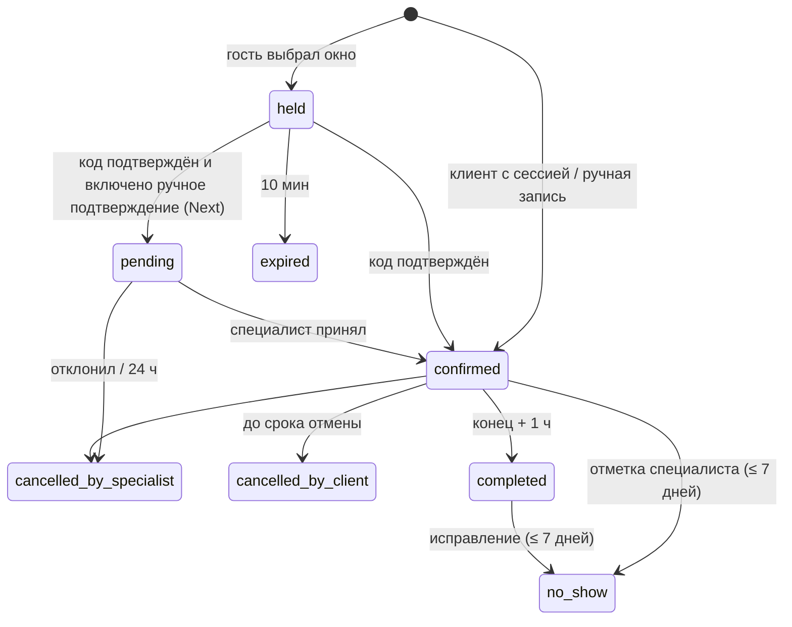

# 15. Модель данных

СУБД — PostgreSQL 16+. Расширения: `btree_gist`, `citext`, `pgcrypto`.

Общие соглашения:
- идентификаторы `uuid` (v7, генерируются приложением — сортируемы по времени), кроме таблиц Better Auth (`text`);
- все временные метки — `timestamptz` (UTC);
- календарные даты рабочих дней — `date` в часовом поясе специалиста;
- время внутри дня — `smallint` минут от полуночи (0–1439);
- колонки `created_at` и `updated_at` есть везде (helper `timestamps` из прототипа), `snake_case`;
- деньги — `integer` в копейках.

## 1. ERD

```mermaid
erDiagram
  USER ||--o{ SESSION : has
  USER ||--o{ ACCOUNT : has
  USER ||--o| SPECIALIST_PROFILE : "becomes"
  SPECIALIST_PROFILE ||--o{ SLUG_HISTORY : "old slugs"
  SPECIALIST_PROFILE ||--o{ SERVICE : offers
  SPECIALIST_PROFILE ||--o{ DAY_TEMPLATE : defines
  DAY_TEMPLATE ||--o{ TEMPLATE_BLOCK : contains
  SERVICE ||--o{ TEMPLATE_BLOCK : "scheduled in"
  SPECIALIST_PROFILE ||--o{ WORK_DAY : plans
  DAY_TEMPLATE |o--o{ WORK_DAY : "source of"
  WORK_DAY ||--o{ WORK_DAY_BLOCK : "snapshot"
  SERVICE ||--o{ WORK_DAY_BLOCK : "scheduled in"
  SPECIALIST_PROFILE ||--o{ BOOKING : receives
  SERVICE ||--o{ BOOKING : "booked as"
  CLIENT_CONTACT ||--o{ BOOKING : "attends"
  SPECIALIST_PROFILE ||--o{ CLIENT_CONTACT : knows
  USER |o--o{ BOOKING : "client account"
  BOOKING ||--o{ BOOKING_EVENT : history
  BOOKING |o--o| BOOKING : "rescheduled_from"
  BOOKING ||--o{ NOTIFICATION : triggers
  BOOKING ||--o| CONSENT_RECORD : "given at"
  USER ||--o{ AUDIT_LOG : acts

  USER {
    text id PK
    citext email UK
    text name
    bool email_verified
    timestamptz deleted_at
  }
  SPECIALIST_PROFILE {
    uuid id PK
    text user_id FK "unique"
    citext slug UK
    text display_name
    text profession
    text about
    text address
    text timezone
    bool booking_enabled
    text horizon_mode
    smallint horizon_days
    date horizon_until
    smallint min_notice_min
    smallint cancel_cutoff_min
  }
  SERVICE {
    uuid id PK
    uuid specialist_id FK
    text name
    smallint duration_min
    smallint buffer_after_min
    int price_kopecks
    bool is_visible
    int sort
    timestamptz archived_at
  }
  DAY_TEMPLATE {
    uuid id PK
    uuid specialist_id FK
    text name
    text color_key
    char code
    timestamptz archived_at
  }
  TEMPLATE_BLOCK {
    uuid id PK
    uuid template_id FK
    uuid service_id FK
    smallint start_min
    smallint count
  }
  WORK_DAY {
    uuid id PK
    uuid specialist_id FK
    date day
    uuid source_template_id FK
    int version
  }
  WORK_DAY_BLOCK {
    uuid id PK
    uuid work_day_id FK
    uuid service_id FK
    smallint start_min
    smallint count
  }
  BOOKING {
    uuid id PK
    uuid specialist_id FK
    uuid service_id FK
    uuid client_contact_id FK
    text client_user_id FK
    timestamptz starts_at
    timestamptz ends_at
    timestamptz blocked_until
    text status
    text source
    timestamptz hold_expires_at
    bytea manage_token_hash UK
    int version
  }
  CLIENT_CONTACT {
    uuid id PK
    uuid specialist_id FK
    text name
    citext email
    text phone
    timestamptz anonymized_at
  }
```



## 2. Сущности

### user, session, account, verification (Better Auth)
- **Назначение:** учётная запись и вход.
- **Поля `user`:** как в прототипе (`id`, `email` UK, `name`, `email_verified`, `image`). Новые: `deleted_at` (мягкое удаление), `theme` (`light|dark|system`).
- **Удаляются из прототипа:** `username`, `display_username`, `phone_number`, `phone_number_verified`, `first_name`, `last_name`, `about`. Профессиональные поля переносятся в `specialist_profile`, телефон — туда же (опционально, публичный по выбору). Username заменяется slug.
- **Доступ:** только сам пользователь.
- **Удаление:** AUTH-04. Обезличивание: `email` → `deleted+{id}@invalid`, `name` → «Удалённый пользователь», сессии удаляются.

### specialist_profile
| Поле | Тип | Обяз. | Ограничения |
|---|---|---|---|
| id | uuid | ✔ | PK |
| user_id | text | ✔ | FK → user, UNIQUE (один профиль на пользователя в MVP) |
| slug | citext | ✔ | UNIQUE, `^[a-z0-9](?:[a-z0-9-]{1,30}[a-z0-9])$`, не в списке зарезервированных |
| display_name | text | ✔ | 1–60 |
| profession | text | — | ≤ 60 |
| about | text | — | ≤ 500 |
| address, address_note | text | — | ≤ 200, ≤ 200 |
| phone_public | text | — | E.164, показывается клиентам, если задан |
| avatar_key | text | — | ключ Object Storage |
| timezone | text | ✔ | IANA (`Europe/Moscow`), проверка по списку |
| booking_enabled | bool | ✔ | default false |
| horizon_mode | text | ✔ | `days|until|unlimited`, default `days` |
| horizon_days | smallint | — | 1–365; обязательно при `days` (CHECK) |
| horizon_until | date | — | обязательно при `until` (CHECK) |
| min_notice_min | smallint | ✔ | 0–4320, default 120 |
| cancel_cutoff_min | smallint | ✔ | 0–4320, default 720 |
| reminders_enabled | bool | ✔ | default true |
| indexable | bool | ✔ | default true (`noindex`, если false) |
| deleted_at | timestamptz | — | — |

- **Жизненный цикл:** создан (онбординг) → опубликован (`booking_enabled`) ⇄ закрыт → удалён (410).
- **Доступ:** чтение публичных полей — все; изменение — владелец.

### slug_history
`(slug citext PK profile_id uuid FK, replaced_at)`. Резерв старого slug на 90 дней и 301-редирект (PRF-02).

### service
| Поле | Тип | Ограничения |
|---|---|---|
| id, specialist_id | uuid | FK, индекс `(specialist_id, sort)` |
| name | text | 1–80 |
| description | text | ≤ 300 |
| duration_min | smallint | 5–720, кратно 5 |
| buffer_after_min | smallint | 0–240, кратно 5 |
| price_kopecks | integer | NULL или 0–100 000 000 |
| price_is_from | bool | «от» |
| is_visible | bool | default true |
| sort | integer | — |
| archived_at | timestamptz | — |

- **Целостность:** физическое удаление запрещено при наличии `booking` или `template_block` / `work_day_block` (FK `ON DELETE RESTRICT`); иначе — архивирование (SVC-02).

### day_template, template_block
- `day_template(id, specialist_id, name 1–40, color_key ∈ {teal, mint, amber, indigo, lilac, slate}, code char(1), archived_at)`.
- `template_block(id, template_id FK ON DELETE CASCADE, service_id FK RESTRICT, start_min 0–1439, count 1–50)`.
- **Правила (проверяются в `domain` и транзакционно при сохранении шаблона целиком):**
  - `start_min + count × (duration + buffer) ≤ 1440`;
  - интервалы блоков не пересекаются.
- **[HYP-01]** Будущая таблица `template_block_service` для блоков «любая из услуг» — не создаётся в MVP.

### work_day, work_day_block
- `work_day(id, specialist_id, day date, source_template_id NULL FK ON DELETE SET NULL, is_modified bool, version int)`, UNIQUE `(specialist_id, day)`.
- Отсутствие строки = выходной.
- `work_day_block(id, work_day_id FK CASCADE, service_id FK RESTRICT, start_min, count)` — **снимок** блоков на дату (D-12). Правила те же, что у `template_block`.
- **Жизненный цикл:** назначение шаблона → (опционально) правка дня (`is_modified = true`) → очистка (DELETE).
- Прошедшие дни не изменяются (CHECK в приложении: `day >= today(tz)`).

### booking
| Поле | Тип | Ограничения |
|---|---|---|
| id | uuid | PK |
| specialist_id | uuid | FK, индекс `(specialist_id, starts_at)` |
| service_id | uuid | FK RESTRICT |
| service_name_snapshot, duration_snapshot, price_snapshot_kopecks | text, smallint, int | снимок на момент записи |
| client_contact_id | uuid | FK (NULL после обезличивания) |
| client_user_id | text | FK → user, NULL для гостя (до входа) |
| client_name_snapshot | text | 1–60 |
| starts_at, ends_at | timestamptz | `ends_at > starts_at` |
| blocked_until | timestamptz | `= ends_at + buffer`, `≥ ends_at` |
| status | text | `held, pending, confirmed, completed, no_show, cancelled_by_client, cancelled_by_specialist, expired` |
| source | text | `online, manual` |
| hold_expires_at | timestamptz | NOT NULL при `held` (CHECK) |
| comment | text | ≤ 300 |
| cancel_reason | text | ≤ 300; обязательно при `cancelled_by_specialist` (CHECK) |
| rescheduled_from_id | uuid | FK → booking |
| manage_token_hash | bytea | UNIQUE, SHA-256 |
| version | int | Оптимистичная блокировка |

**Инвариант (BKG-02):**
```sql
ALTER TABLE booking ADD CONSTRAINT booking_no_overlap
  EXCLUDE USING gist (
    specialist_id WITH =,
    tstzrange(starts_at, blocked_until, '[)') WITH &&
  ) WHERE (status IN ('held','pending','confirmed'));
```
Просроченные `held` переводятся в `expired` задачей `expire_holds` и в транзакции создания записи. Предикат ограничения не может зависеть от `now()`.

### booking_event
`(id, booking_id, at, actor_type: client|specialist|system, actor_user_id, type: created|confirmed|rescheduled|cancelled|completed|no_show|reminder_sent, data jsonb без ПД)` — история для CAL-02 и разбирательств.

### client_contact
- `(id, specialist_id, name, email citext, phone, first_booking_at, last_booking_at, bookings_count, anonymized_at)`, UNIQUE `(specialist_id, email)` WHERE email IS NOT NULL.
- **Изоляция:** у каждого специалиста свой набор; один человек у двух специалистов — две записи (CLI-01 AC1).

### consent_record
`(id, subject_email citext, user_id NULL, specialist_id, booking_id NULL, purpose: booking_processing, document_version, given_at, ip inet, user_agent text, withdrawn_at)`.

### notification
`(id, booking_id NULL, user_id NULL, kind, channel: email, to_hash, scheduled_at, sent_at, status, attempts, provider_message_id, last_error)`. Адрес получателя не хранится открыто, берётся из связанных сущностей при отправке.

### audit_log
`(id, at, actor_user_id, action, entity, entity_id, request_id, meta jsonb)` для изменений профиля, расписания, удаления, запросов субъектов, действий оператора.

### analytics_event
`(id, at, name, specialist_id NULL, session_hash, props jsonb)`. Без ПД и IP; `session_hash` — суточная соль.

### feature_flag, dsr_request
- `feature_flag(key, enabled, rules jsonb)`.
- `dsr_request(id, email, type: access|delete|withdraw, status, created_at, closed_at)`.

## 3. Индексы (ключевые)
- `booking (specialist_id, starts_at)`; `booking (client_user_id, starts_at)`; `booking (status, hold_expires_at) WHERE status='held'`; gist из инварианта.
- `work_day (specialist_id, day)` UNIQUE.
- `service (specialist_id) WHERE archived_at IS NULL`.
- `client_contact (specialist_id, lower(name))`, `trgm` для поиска — Next.

## 4. Машина состояний записи



Перенос = `confirmed → cancelled_by_*` для старой записи и новая `confirmed` с `rescheduled_from_id` в одной транзакции.

## 5. Права доступа (сводно)

| Сущность | Гость | Клиент | Специалист-владелец | Система |
|---|---|---|---|---|
| specialist_profile (публичные поля) | R | R | RW | R |
| service, окна | R (видимые) | R | RW | R |
| day_template, work_day | — | — | RW | R |
| booking | создать hold; R/отмена/перенос по токену | R/отмена/перенос своих | RW своих | RW |
| client_contact | — | — | RW своих | RW |
| consent_record | создать | создать | R (по своим записям) | R |
| audit_log, notification | — | — | — | RW |

## 6. Хранение и удаление

| Данные | Срок | Основание и действие |
|---|---|---|
| Аккаунт удалён | Обезличивание ≤ 30 дней | ст. 21 152-ФЗ |
| Записи (прошедшие) | 3 года, затем обезличивание клиентских полей | Разбор споров; срок — **гипотеза, утвердить с юристом** |
| client_contact без записей 3 года | Обезличивание | Минимизация |
| verification (коды) | Удаление после использования или ≤ 24 ч | — |
| Истёкшие hold | Удаление через 7 дней | — |
| consent_record | Срок обработки + 3 года | Доказательство согласия |
| audit_log | 1 год | Безопасность |
| Логи приложения | 30 дней | Без ПД |
| Резервные копии | 30 дней (PITR 7 дней) | [19](19-infrastructure.md) |

## 7. Аудит
`audit_log` пишется в той же транзакции, что и изменение. Изменения записей дополнительно — в `booking_event`.

## 8. Миграция из прототипа
Продуктивных данных в прототипе нет (моки). Переносятся только схемы Better Auth (с удалением неиспользуемых полей) и Zod-ограничения профиля. Миграция пользователей не требуется **[Факт: нет production-окружения в репозитории; Неизвестно: есть ли реальные пользователи — Q-02]**.
