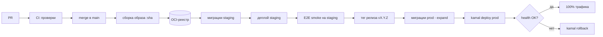

# 19. Инфраструктура и эксплуатация

## 1. Локальный запуск (целевой)

Замена `scripts/setup.sh` из прототипа: тот определял IP через `ifconfig en0` и работал только на macOS. Для web он не нужен — всё на `localhost`.

```
pnpm i
cp .env.example .env            # значения по умолчанию для локали
docker compose up -d            # postgres:17, mailpit (SMTP + UI), minio (S3)
pnpm db:migrate && pnpm db:seed
pnpm dev                        # web :3000, worker
```

- `.env.example` содержит только безопасные значения по умолчанию.
- Валидация окружения при старте — `@t3-oss/env-core` (из прототипа).
- Работает на macOS, Linux и Windows (WSL2).
- Требования: **Node.js 26** (Active LTS с 28.10.2026; до этой даты — ветка Current той же версии), pnpm 10, Docker. Версия зафиксирована в `.nvmrc` и `engines`, образ — `node:26-slim`.

## 2. Окружения и конфигурация

| Окружение | Где | Деплой | Данные | Доступ |
|---|---|---|---|---|
| local | Машина разработчика | — | Сиды | Разработчик |
| ci | GitHub Actions + Testcontainers | — | Сиды | CI |
| staging | VM у провайдера в РФ (отдельный проект) | Автоматически из `main` | Сиды | Команда, пилотные тестировщики |
| production | VM у провайдера в РФ (отдельный проект) | Ручное подтверждение релиза (тег) | Реальные | Ограниченный |

Конфигурация:
- переменные окружения (12-factor);
- секреты — в зашифрованных SOPS-файлах, подставляются при деплое (§6);
- feature flags — таблица в БД;
- разные домены: `staging.akkurat.ru` (с `noindex` и Basic Auth) и `akkurat.ru`.

## 3. Сборка и автоматические проверки (CI)

На каждый PR:
1. `pnpm install --frozen-lockfile`.
2. Typecheck, lint, knip.
3. Unit и компонентные тесты.
4. Интеграционные тесты (Testcontainers).
5. E2E smoke (Chromium).
6. Сборка образа.
7. Lighthouse CI на собранном образе.
8. gitleaks, OSV-Scanner.

Turborepo кэширует задачи. Ночью: полный E2E (3 движка), визуальная регрессия, ZAP baseline против staging, k6 (TP-1) против staging.

## 4. CI/CD и развёртывание



- Миграции — отдельная задача (job) с блокировкой (`pg_advisory_lock`), forward-only, expand/contract.
- Откат приложения — `kamal rollback` на предыдущий образ; данные не откатываются.
- Релизы — по SemVer, CHANGELOG.

**GitHub Actions:** код уже на GitHub. Если доступ ограничат, запасной вариант — self-hosted GitLab CE или Gitea с раннерами в РФ. Пайплайн описан как shell-скрипты, вызываемые из YAML, для переносимости.

## 5. Платформа без привязки к провайдеру

**[Решение D-16, пересмотрено 11.10.2026 по решению владельца]** Продукт не зависит от сервисов конкретного облака. Каждый компонент опирается на открытый стандарт или open-source, которые есть у любого российского провайдера или разворачиваются самостоятельно. Смена провайдера — перенос данных и смена переменных окружения, без изменения кода.

| Компонент | Стандарт / решение | Где взять (взаимозаменяемо) |
|---|---|---|
| Вычисления | OCI-контейнеры (Docker), Linux-VM | Любой провайдер VM в РФ: Selectel, Timeweb Cloud, VK Cloud, Yandex Cloud, собственный сервер |
| Развёртывание | **Kamal 2** (деплой контейнеров по SSH с нулевым простоем и откатом) — без Kubernetes в MVP | Любые VM |
| Входящий трафик и TLS | kamal-proxy + Let's Encrypt; при ≥ 2 хостах — L4/L7-балансировщик провайдера или HAProxy | Любой |
| База данных | **PostgreSQL 17** (стандартный протокол; только штатные расширения `btree_gist`, `citext`, `pgcrypto`) | Managed PostgreSQL любого провайдера или собственный кластер (Patroni) |
| Файлы | **S3-совместимый API** | Объектное хранилище любого провайдера или MinIO |
| Почта | **SMTP** через абстракцию `MailTransport` (nodemailer) | Любой российский SMTP-провайдер (например, Unisender Go, Mailganer, почтовый сервис облака); второй провайдер — резерв |
| Секреты | **SOPS + age** (зашифрованные файлы в репозитории) → переменные окружения при деплое | Не зависит от облака |
| Реестр образов | OCI Registry | Реестр провайдера или self-hosted (Gitea/Harbor); образы не содержат ПД |
| Метрики и логи | OpenTelemetry Collector → **VictoriaMetrics + VictoriaLogs + Grafana** (self-hosted) | Отдельная небольшая VM |
| Ошибки | **GlitchTip** (self-hosted, Sentry-совместимый) | Та же VM мониторинга |
| Uptime | Внешний пинг-сервис + алерты в Telegram | Любой |
| Резервные копии | **WAL-G / pg_dump → S3 другого провайдера** | Межпровайдерная копия — защита от отказа или ухода провайдера |
| CDN | Опционально, только для статики (без ПД) | Любой CDN |

**Правила независимости:**
- в коде нет SDK конкретного облака — только S3-, SMTP- и PostgreSQL-клиенты;
- инфраструктура описана как код (Kamal-конфиг, при необходимости Terraform/OpenTofu с провайдером, вынесенным в переменные);
- бэкапы всегда хранятся у **другого** провайдера, чем основная БД;
- ежегодно (или при смене условий) — учение «переезд на другого провайдера» на staging.

### 5.1 Выбор стартового провайдера

| Провайдер | Плюсы | Минусы |
|---|---|---|
| **Selectel (рекомендуется для старта)** | Managed PostgreSQL, S3, VM; аттестация по 152-ФЗ до УЗ-1; собственные ЦОД | Почта — сторонний SMTP |
| Timeweb Cloud | Дешевле всего для пилота; Managed PG, S3 | Меньше PaaS-сервисов |
| VK Cloud, Yandex Cloud | Широкий набор сервисов | Не используем их проприетарные сервисы — выбор только по цене VM, PG и S3 |

Стартовая конфигурация MVP:
- 2 VM (web + worker, по контейнеру каждого на каждой VM; Kamal);
- Managed PostgreSQL (HA, 2 хоста) или 1 хост для пилота;
- S3 у того же провайдера;
- бэкапы в S3 второго провайдера;
- 1 VM мониторинга (VictoriaMetrics, VictoriaLogs, Grafana, GlitchTip).

Порог пересмотра провайдера — стоимость > X ₽/мес при < Y активных специалистов или ухудшение SLA (значения задаёт владелец, Q-07).

Почта:
- домены отправки: `mail.akkurat.ru` с SPF, DKIM, DMARC;
- основной и резервный SMTP-провайдеры в РФ;
- отдельный поток для кодов входа (высокий приоритет).

## 6. Секреты

| Секрет | Хранение | Ротация |
|---|---|---|
| `BETTER_AUTH_SECRET` | SOPS-файл окружения → env контейнера | Ежегодно и при инциденте (инвалидирует сессии — планово ночью) |
| `DATABASE_URL` (пароль) | SOPS → env | Раз в полгода |
| Ключи S3, SMTP | SOPS → env; учётные записи с минимальными правами | Раз в полгода |
| SSH-ключ деплоя, ключ age | Секреты CI; ключ age production — только у ответственных лиц | При смене состава команды |

## 7. Миграции

- Drizzle: схема на TS → `drizzle-kit generate` → **ревью SQL** → коммит.
- Нестандартные объекты (`EXCLUDE`, расширения, CHECK) — в ручных SQL-миграциях.
- Перед production — прогон на снапшоте staging.
- Крупные изменения таблицы `booking` — с `CREATE INDEX CONCURRENTLY` и батчами.

## 8. Резервное копирование и восстановление

| Параметр | Значение |
|---|---|
| Бэкапы PG | WAL-G: непрерывная архивация WAL + ежедневная базовая копия в S3 **другого провайдера**, хранение 30 дней |
| PITR | 7 дней (RPO ≤ 15 мин по журналу) |
| Логический дамп | Еженедельно `pg_dump` в отдельный бакет с иными учётными данными (защита от ошибочного удаления кластера и от отказа провайдера) |
| Object Storage (аватары) | Версионирование 30 дней |
| Проверка | Ежеквартальное восстановление (TR-1), RTO ≤ 4 ч |
| Шифрование | Шифрование бэкапов на стороне клиента (WAL-G/age) + TLS |

## 9. Мониторинг и обработка ошибок

- Дашборды: трафик и ошибки по маршрутам, p95, очередь (длина, возраст, dead-letter), письма (отправлено, ошибки, bounce), БД (CPU, соединения, медленные запросы), бизнес-метрики (записи в час, 409 `slot_taken`).
- Uptime-проверки: `/{тестовый slug}`, `/api/v1/public/specialists/{тестовый}/availability`, `/healthz` — каждую минуту из 2 регионов.
- Алерты ([14](14-architecture.md) §10) — в Telegram-чат команды и на email.
- Ошибки — GlitchTip (self-hosted, РФ).

## 10. Восстановление после сбоев (runbooks)

| Сбой | Действия |
|---|---|
| Web 5xx после релиза | Откат ревизии → разбор |
| Недоступность БД | Failover HA-кластера; при длительном сбое — восстановление из WAL-G в новый кластер (в т. ч. у другого провайдера), переключение `DATABASE_URL` |
| Почтовый провайдер недоступен | Очередь копит задачи (повторы); при > 30 мин — переключение на резервного провайдера (абстракция `MailTransport`) |
| Очередь растёт | Масштабирование worker; проверка dead-letter |
| Утечка секрета | Ротация, отзыв сессий, инцидентный процесс ([17](17-security-and-compliance.md) §4) |
| Ошибочное массовое изменение данных | PITR в отдельный кластер → выборочное восстановление строк по `audit_log` |

## 11. Эксплуатационный минимум для пилота
- Один ответственный дежурный (рабочее время), SLA ответа на S1 — 2 ч.
- Страница статуса — Next.
- Регламент доступа к production и журнал.
