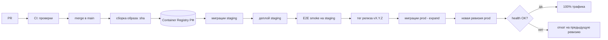

# 19. Инфраструктура и эксплуатация

## 1. Локальный запуск (целевой)

Замена `scripts/setup.sh` из прототипа: тот определял IP через `ifconfig en0` и работал только на macOS. Для web он не нужен — всё на `localhost`.

```
pnpm i
cp .env.example .env            # значения по умолчанию для локали
docker compose up -d            # postgres:17, mailpit (SMTP + UI), minio (S3)
pnpm db:migrate && pnpm db:seed
pnpm dev                        # web :3000, worker
```

- `.env.example` содержит только безопасные значения по умолчанию.
- Валидация окружения при старте — `@t3-oss/env-core` (из прототипа).
- Работает на macOS, Linux и Windows (WSL2).
- Требования: **Node.js 26** (Active LTS с 28.10.2026; до этой даты — ветка Current той же версии), pnpm 10, Docker. Версия зафиксирована в `.nvmrc` и `engines`, образ — `node:26-slim`.

## 2. Окружения и конфигурация

| Окружение | Где | Деплой | Данные | Доступ |
|---|---|---|---|---|
| local | Машина разработчика | — | Сиды | Разработчик |
| ci | GitHub Actions + Testcontainers | — | Сиды | CI |
| staging | Облако РФ, отдельный каталог (folder) | Автоматически из `main` | Сиды | Команда, пилотные тестировщики |
| production | Облако РФ, отдельный каталог | Ручное подтверждение релиза (тег) | Реальные | Ограниченный |

Конфигурация:
- переменные окружения (12-factor);
- секреты — в Lockbox (Yandex Cloud) или аналоге, подставляются при деплое;
- feature flags — таблица в БД;
- разные домены: `staging.vporu.ru` (с `noindex` и Basic Auth) и `vporu.ru`.

## 3. Сборка и автоматические проверки (CI)

На каждый PR:
1. `pnpm install --frozen-lockfile`.
2. Typecheck, lint, knip.
3. Unit и компонентные тесты.
4. Интеграционные тесты (Testcontainers).
5. E2E smoke (Chromium).
6. Сборка образа.
7. Lighthouse CI на собранном образе.
8. gitleaks, OSV-Scanner.

Turborepo кэширует задачи. Ночью: полный E2E (3 движка), визуальная регрессия, ZAP baseline против staging, k6 (TP-1) против staging.

## 4. CI/CD и развёртывание



- Миграции — отдельная задача (job) с блокировкой (`pg_advisory_lock`), forward-only, expand/contract.
- Откат приложения — переключение на предыдущую ревизию; данные не откатываются.
- Релизы — по SemVer, CHANGELOG.

**GitHub Actions:** код уже на GitHub. Если доступ ограничат, запасной вариант — self-hosted GitLab CE или Gitea с раннерами в РФ. Пайплайн описан как shell-скрипты, вызываемые из YAML, для переносимости.

## 5. Хостинг: сравнение и рекомендация

Требования:
- ПД в РФ (152-ФЗ);
- managed PostgreSQL с PITR;
- контейнеры с автомасштабированием или простые VM;
- S3-хранилище;
- транзакционная почта;
- бюджет MVP — минимальный.

| Вариант | Состав | Плюсы | Минусы | Ориентир стоимости |
|---|---|---|---|---|
| **A. Yandex Cloud (рекомендуется)** | Serverless Containers (web, worker с min 1), Managed PostgreSQL, Object Storage + CDN, Postbox, Lockbox, Cloud Logging и Monitoring, Container Registry, Smart Web Security | Минимум эксплуатации, всё в одном облаке, почта в РФ, заявленное соответствие 152-ФЗ | Привязка к сервисам (смягчается: контейнер, Postgres, S3, SES-совместимое API почты) | **[Неизвестно]** Рассчитать калькулятором провайдера перед стартом |
| B. Selectel | Managed PG, Managed Kubernetes или VM, S3, сторонняя почта (Unisender Go) | Сертификация до УЗ-1, независимость, хорошая сеть | Больше эксплуатации; K8s избыточен для MVP | — |
| C. Timeweb Cloud (бюджетный пилот) | 1–2 VM + Docker Compose (web, worker, Caddy), Managed PG, S3, Unisender Go | Дёшево, просто | Ручное масштабирование и обновления ОС | — |

**[Решение D-16]** Вариант A. Порог пересмотра — стоимость инфраструктуры > X ₽/мес при < Y активных специалистов (значения задаёт владелец, Q-07).

Почта:
- Yandex Cloud Postbox или Unisender Go (оба в РФ);
- домены отправки: `mail.vporu.ru` с SPF, DKIM, DMARC;
- отдельный поток для кодов входа (высокий приоритет).

## 6. Секреты

| Секрет | Хранение | Ротация |
|---|---|---|
| `BETTER_AUTH_SECRET` | Lockbox | Ежегодно и при инциденте (инвалидирует сессии — планово ночью) |
| `DATABASE_URL` (пароль) | Lockbox | Раз в полгода |
| Ключи S3, почты | Lockbox, сервисные аккаунты с минимальными правами | Раз в полгода |
| Ключи CI для деплоя | OIDC-федерация (без долгоживущих ключей), если поддерживается | — |

## 7. Миграции

- Drizzle: схема на TS → `drizzle-kit generate` → **ревью SQL** → коммит.
- Нестандартные объекты (`EXCLUDE`, расширения, CHECK) — в ручных SQL-миграциях.
- Перед production — прогон на снапшоте staging.
- Крупные изменения таблицы `booking` — с `CREATE INDEX CONCURRENTLY` и батчами.

## 8. Резервное копирование и восстановление

| Параметр | Значение |
|---|---|
| Автоматические бэкапы PG | Ежедневно, хранение 30 дней |
| PITR | 7 дней (RPO ≤ 15 мин по журналу) |
| Логический дамп | Еженедельно в отдельный бакет с иным сервисным аккаунтом (защита от ошибочного удаления кластера) |
| Object Storage (аватары) | Версионирование 30 дней |
| Проверка | Ежеквартальное восстановление (TR-1), RTO ≤ 4 ч |
| Шифрование | Провайдер (at rest) + TLS |

## 9. Мониторинг и обработка ошибок

- Дашборды: трафик и ошибки по маршрутам, p95, очередь (длина, возраст, dead-letter), письма (отправлено, ошибки, bounce), БД (CPU, соединения, медленные запросы), бизнес-метрики (записи в час, 409 `slot_taken`).
- Uptime-проверки: `/{тестовый slug}`, `/api/v1/public/specialists/{тестовый}/availability`, `/healthz` — каждую минуту из 2 регионов.
- Алерты ([14](14-architecture.md) §10) — в Telegram-чат команды и на email.
- Ошибки — GlitchTip (self-hosted, РФ).

## 10. Восстановление после сбоев (runbooks)

| Сбой | Действия |
|---|---|
| Web 5xx после релиза | Откат ревизии → разбор |
| Недоступность БД | Managed failover (HA-кластер с 2 хостами в production); при длительном сбое — восстановление из PITR в новый кластер, переключение `DATABASE_URL` |
| Почтовый провайдер недоступен | Очередь копит задачи (повторы); при > 30 мин — переключение на резервного провайдера (абстракция `MailTransport`) |
| Очередь растёт | Масштабирование worker; проверка dead-letter |
| Утечка секрета | Ротация, отзыв сессий, инцидентный процесс ([17](17-security-and-compliance.md) §4) |
| Ошибочное массовое изменение данных | PITR в отдельный кластер → выборочное восстановление строк по `audit_log` |

## 11. Эксплуатационный минимум для пилота
- Один ответственный дежурный (рабочее время), SLA ответа на S1 — 2 ч.
- Страница статуса — Next.
- Регламент доступа к production и журнал.
